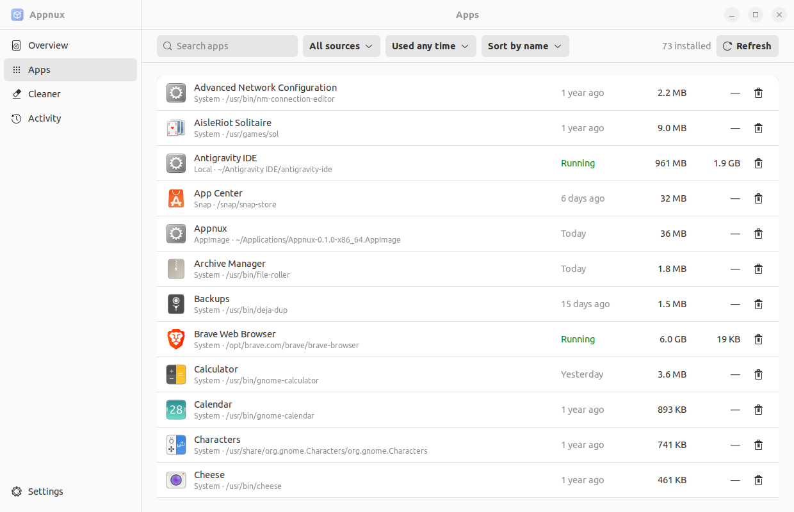

<p align="center"></p>

<h1 align="center">Appnux</h1>

<p align="center"><b>See, uninstall and clean every app on Linux.</b><br>
System packages, Flatpak, Snap and AppImage in one window: where each app lives, what it takes, when you last used it, and a clean way to remove it.</p>

<p align="center"><b>English</b> · <a href="README.vi.md">Tiếng Việt</a></p>



## Why

Apps on Linux arrive four ways: a system package (apt, pacman, dnf), a Flatpak, a Snap, or an AppImage file you downloaded and clicked. Each one keeps its files somewhere else, and none of them cleans up after itself. Appnux lists them all in one place and removes them cleanly.

## Features

- **One list for every app.** System packages on Debian/Ubuntu, Arch and Fedora/RHEL, Flatpak (user and system), Snap, and AppImage files anywhere in your home folder.
- **Where it lives.** Every row shows the format and the path. "Open folder" opens it in your file manager.
- **When you last used it.** Filter by "Not used in 3 months" to find what you forgot about.
- **What it really takes.** The package plus its config, data and cache in your home folder, with hard links counted once.
- **Memory per app**, for the apps running now.
- **Uninstall or Deep purge.** Uninstall keeps your settings. Deep purge also deletes what the app left behind, each folder marked *Sure*, *Likely* or *Unsure*. System packages are removed only after the package manager's dry run.
- **A cleaner that only cleans.** Package caches, old system logs, thumbnails, developer tool caches (npm, Yarn, pnpm, pip, uv, Go, Cargo), caches of apps that are not running, and broken menu shortcuts. It never touches `node_modules`, Cargo `target`, Docker or your files. See [docs/CLEANER.md](docs/CLEANER.md).
- **Activity log** with every step that ran and whether it worked.
- **Native GTK4 and libadwaita**, light and dark, about 66 MB of memory.

## Install

Appnux needs GTK 4.6 and libadwaita 1.1 or newer: Ubuntu 22.04+, Debian 12+, Linux Mint 21+, Fedora 36+, Arch and its derivatives.

Download from the [latest release](https://github.com/MinduLabs/Appnux/releases/latest).

**Debian, Ubuntu, Mint**

```sh
sudo apt install ./appnux_0.1.0_amd64.deb
```

**Any distro (AppImage)**

```sh
chmod +x Appnux-0.1.0-x86_64.AppImage
./Appnux-0.1.0-x86_64.AppImage
```

**From source**

```sh
# Ubuntu / Debian: sudo apt install build-essential pkg-config libgtk-4-dev libadwaita-1-dev
# Fedora: sudo dnf install gtk4-devel libadwaita-devel
# Arch: sudo pacman -S gtk4 libadwaita
git clone https://github.com/MinduLabs/Appnux
cd Appnux
cargo build --release -p appnux
./target/release/appnux
```

## Using it

1. **Apps:** find an app, see where it lives, and press the bin icon to uninstall it. Open the details for Deep purge.
2. **Cleaner:** what is safe is already ticked. Review, then clean. System caches ask for your password once.
3. **Activity:** every step that ran, with ✓ or the reason it failed.

Removing deletes for good after you confirm. Nothing goes to the Trash.

## How it is safe

- Every path is checked before it is removed: inside your home folder, inside the folders Appnux cleans, never one of those folders itself, never `~/.ssh`, `~/.gnupg` or your documents, never through a symlink.
- No shell commands are built. Each step is a fixed command or a single file operation.
- System work goes through PolicyKit (`pkexec appnux --root-helper`), which checks every name again and re-runs the package manager's dry run before removing a package.

## Development

```
crates/appnux-core   all logic: app discovery, sizes, residue, cleaner, plans, actions
app                  the GTK4 + libadwaita interface
packaging            .desktop, icons, PolicyKit rule, build-deb.sh, build-appimage.sh
site                 the GitHub Pages landing page
docs                 PLAN, CLEANER, STYLE-GUIDE
```

```sh
cargo fmt --all --check
cargo clippy --workspace --all-targets -- -D warnings
cargo test --workspace
packaging/build-deb.sh          # dist/appnux_<version>_amd64.deb
packaging/fetch-linuxdeploy.sh  # once
packaging/build-appimage.sh     # dist/Appnux-<version>-x86_64.AppImage
```

**Releasing:** set `version` in `Cargo.toml`, commit, then push a matching tag (`git tag v0.2.0 && git push origin v0.2.0`). GitHub Actions builds the .deb and the AppImage on Ubuntu 22.04 and publishes the release.

## License

Appnux is free software under the [GNU General Public License v3.0 or later](LICENSE), with one additional term under Section 7(b) of the GPL ([NOTICE](NOTICE)):

> If you share Appnux, a modified version of it, or a work based on its source code, keep the NOTICE file and give visible credit: **"Based on Appnux by MinduLabs (https://github.com/MinduLabs/Appnux)"**, in your README and, for an app, in its About screen.

Copyright © 2026 MinduLabs and the Appnux contributors.
