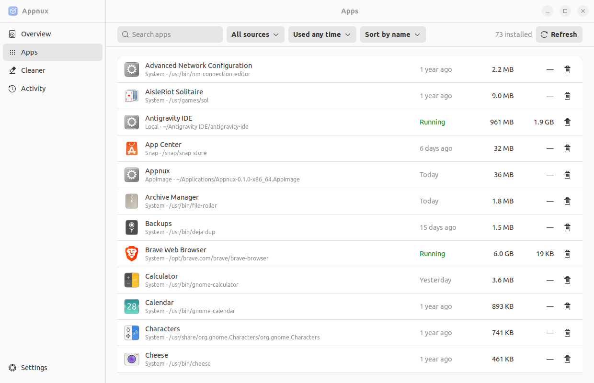

<p align="center"></p>

<h1 align="center">Appnux</h1>

<p align="center"><b>Xem, gỡ và dọn mọi ứng dụng trên Linux.</b><br>
Gói hệ thống, Flatpak, Snap và AppImage trong một cửa sổ: app nằm ở đâu, chiếm bao nhiêu, dùng lần cuối khi nào, và gỡ sạch bằng một nút.</p>

<p align="center"><a href="README.md">English</a> · <b>Tiếng Việt</b></p>



## Vì sao có Appnux

Ứng dụng trên Linux đến từ bốn ngả: gói hệ thống (apt, pacman, dnf), Flatpak, Snap, hoặc file AppImage bạn tải về rồi bấm chạy. Mỗi kiểu để file ở một chỗ khác nhau, và không kiểu nào tự dọn những gì nó để lại. Appnux gom tất cả về một danh sách và gỡ chúng sạch sẽ.

## Tính năng

- **Một danh sách cho mọi app.** Gói hệ thống trên Debian/Ubuntu, Arch và Fedora/RHEL, Flatpak (cài cho user và cho toàn hệ thống), Snap, và file AppImage ở bất kỳ đâu trong thư mục home.
- **App nằm ở đâu.** Mỗi dòng hiện loại gói và đường dẫn. Nút "Open folder" mở đúng thư mục trong trình quản lý file.
- **Dùng lần cuối khi nào.** Lọc "Not used in 3 months" để tìm app đã quên.
- **Thực sự chiếm bao nhiêu.** Gói cộng với config, data và cache của app trong home, file hard link chỉ tính một lần.
- **RAM của từng app** đang chạy.
- **Uninstall hoặc Deep purge.** Uninstall giữ lại cài đặt của bạn. Deep purge xóa luôn những gì app để lại, mỗi thư mục được gắn mức *Sure*, *Likely* hoặc *Unsure*. Gói hệ thống chỉ bị gỡ sau khi package manager chạy thử (dry run).
- **Trình dọn chỉ dọn rác.** Cache gói, log hệ thống cũ, thumbnail, cache của công cụ dev (npm, Yarn, pnpm, pip, uv, Go, Cargo), cache của app không đang chạy, và shortcut hỏng trong menu. Không bao giờ đụng tới `node_modules`, Cargo `target`, Docker hay file của bạn. Xem [docs/CLEANER.md](docs/CLEANER.md).
- **Nhật ký Activity** ghi từng bước đã chạy và kết quả.
- **GTK4 và libadwaita native**, có light và dark, dùng khoảng 66 MB RAM.

## Cài đặt

Cần GTK 4.6 và libadwaita 1.1 trở lên: Ubuntu 22.04+, Debian 12+, Linux Mint 21+, Fedora 36+, Arch và các bản dựa trên Arch.

Tải ở [bản phát hành mới nhất](https://github.com/MinduLabs/Appnux/releases/latest).

**Debian, Ubuntu, Mint**

```sh
sudo apt install ./appnux_0.1.0_amd64.deb
```

**Mọi distro (AppImage)**

```sh
chmod +x Appnux-0.1.0-x86_64.AppImage
./Appnux-0.1.0-x86_64.AppImage
```

**Build từ mã nguồn**

```sh
# Ubuntu / Debian: sudo apt install build-essential pkg-config libgtk-4-dev libadwaita-1-dev
# Fedora: sudo dnf install gtk4-devel libadwaita-devel
# Arch: sudo pacman -S gtk4 libadwaita
git clone https://github.com/MinduLabs/Appnux
cd Appnux
cargo build --release -p appnux
./target/release/appnux
```

## Cách dùng

1. **Apps:** tìm app, xem nó nằm ở đâu, bấm biểu tượng thùng rác để gỡ. Mở phần chi tiết để Deep purge.
2. **Cleaner:** những gì an toàn đã được tick sẵn. Xem lại rồi bấm dọn. Cache hệ thống sẽ hỏi mật khẩu một lần.
3. **Activity:** từng bước đã chạy, có dấu ✓ hoặc lý do thất bại.

Sau khi bạn xác nhận, Appnux xóa vĩnh viễn. Không có gì bị đưa vào Thùng rác.

## An toàn thế nào

- Mọi đường dẫn đều được kiểm tra trước khi xóa: phải nằm trong home, trong các thư mục Appnux dọn, không bao giờ là chính các thư mục đó, không bao giờ là `~/.ssh`, `~/.gnupg` hay tài liệu của bạn, không bao giờ đi qua symlink.
- Không dựng lệnh shell. Mỗi bước là một lệnh cố định hoặc một thao tác file duy nhất.
- Việc cần quyền root đi qua PolicyKit (`pkexec appnux --root-helper`). Helper kiểm tra lại mọi tên gói và chạy thử lại package manager trước khi gỡ.

## Phát triển

```
crates/appnux-core   toàn bộ logic: tìm app, đo dung lượng, file còn sót, cleaner, kế hoạch, thực thi
app                  giao diện GTK4 + libadwaita
packaging            .desktop, icon, rule PolicyKit, build-deb.sh, build-appimage.sh
site                 trang giới thiệu trên GitHub Pages
docs                 PLAN, CLEANER, STYLE-GUIDE
```

```sh
cargo fmt --all --check
cargo clippy --workspace --all-targets -- -D warnings
cargo test --workspace
packaging/build-deb.sh          # dist/appnux_<version>_amd64.deb
packaging/fetch-linuxdeploy.sh  # chạy một lần
packaging/build-appimage.sh     # dist/Appnux-<version>-x86_64.AppImage
```

**Phát hành:** sửa `version` trong `Cargo.toml`, commit, rồi push tag khớp với version (`git tag v0.2.0 && git push origin v0.2.0`). GitHub Actions sẽ build .deb và AppImage trên Ubuntu 22.04 và tạo bản phát hành.

## Giấy phép

Appnux là phần mềm tự do theo [GNU General Public License v3.0 trở lên](LICENSE), kèm một điều khoản bổ sung theo Mục 7(b) của GPL ([NOTICE](NOTICE)):

> Nếu bạn phân phối Appnux, bản đã sửa đổi, hoặc sản phẩm dựa trên mã nguồn của nó, bạn phải giữ file NOTICE và ghi nguồn rõ ràng: **"Based on Appnux by MinduLabs (https://github.com/MinduLabs/Appnux)"** trong README, và với ứng dụng thì ở cả màn hình About.

Bản dịch này chỉ để tham khảo; văn bản có hiệu lực là [LICENSE](LICENSE) và [NOTICE](NOTICE) bằng tiếng Anh.

Copyright © 2026 MinduLabs và những người đóng góp cho Appnux.
